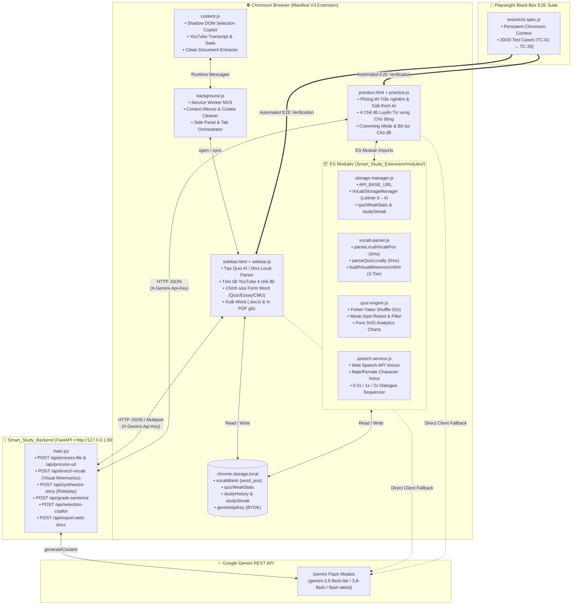

# 🎓 Smart Study Extension (`v1.0`)

> **Local-First AI Learning Copilot, Leitner 4-Box SRS, Active English Production & Exam Practice Room**
> Kiến trúc Hybrid kết hợp **Chrome Extension Manifest V3 (ES Modules)**, **Python FastAPI Backend**, **Google Gemini API (BYOK)** và bộ kiểm thử tự động **Playwright Black-Box E2E (`20/20 passed`)**.

---

## 🌟 1. Tổng quan Dự án

**Smart Study Extension (`v1.0`)** là trợ lý học tập và xử lý tài liệu toàn diện tích hợp trực tiếp trên trình duyệt Chromium. Dự án được thiết kế theo triết lý **Local-First Hybrid Architecture**:
- **Tốc độ phản hồi tức thì (`0ms`):** Bóc tách cục bộ danh sách từ vựng tiếng Anh có nhãn từ loại (`word (pos): meaning`) và đề thi trắc nghiệm có sẵn (`Câu 1... A. B. C. D.`) từ văn bản hoặc file `.docx` (kèm nén ảnh nhúng sang WebP qua `<canvas>`) mà không tốn băng thông hay quota API.
- **Trí tuệ nhân tạo đa tầng (Gemini API — BYOK):** Người dùng tự quản lý API Key cá nhân (`chrome.storage.local['geminiApiKey']`), hỗ trợ chuỗi fallback model sống tốc độ cao (`gemini-3.5-flash-lite` → `gemini-3.8-flash` → `gemini-flash-latest`) để tạo đề trắc nghiệm từ tài liệu thô, làm giàu minh họa ngữ nghĩa 3 tầng (`Semantic Visual Mnemonics`), chấm câu tiếng Anh và tổng hợp kịch bản hội thoại thực chiến.
- **Kiến trúc ES Modules & Kiểm thử E2E chuẩn kỹ thuật phần mềm:** Mã nguồn Phòng luyện tập được mô-đun hóa rõ ràng dưới `modules/` và được bảo vệ chống hồi quy bởi **20 kịch bản kiểm thử hộp đen Playwright (`TC-01` → `TC-20`)**.

---

## 🏗️ 2. Sơ đồ Kiến trúc Hệ thống (Mermaid.js)



---

## 🚀 3. Các Nhóm Tính năng Cốt lõi

### 3.1. Tạo Quiz Hybrid (`0ms` Local-First & Gemini AI)
- **3 nguồn nhập liệu linh hoạt:** `📄 Từ File` (`.docx`, `.pdf`), `🌐 Trang Web` (tóm tắt & rút trích từ khóa từ tab đang mở) và `✍️ Dán Chữ`.
- **Bóc tách cục bộ `0ms`:**
  - Tự động nhận diện danh sách từ vựng tiếng Anh có nhãn từ loại (`word (pos): meaning`) hoặc từ điển `word: meaning`.
  - Tự động bóc tách đề trắc nghiệm có sẵn (`Câu 1... A. B. C. D.`) được đánh dấu đáp án bằng chữ **in đậm**, dấu `*` hoặc bảng `Answers` cuối file, giữ nguyên hình ảnh minh họa đã nén sang WebP.
- **3 chế độ tạo đề:** *Độ bình thường (Giữ nguyên thứ tự file)*, *Độ khó: Lộn xộn (Xáo trộn câu & đáp án bằng thuật toán Fisher-Yates `O(n)`)*, và *Từ vựng tiếng Anh*.

### 3.2. Phòng Luyện tập Trắc nghiệm, `Weak-Spot Retest` & Giải thích AI kèm `Memory Cue`
- **Giải thích thông minh theo yêu cầu (`💡 Giải thích vì sao đúng/sai`):**
  - Hiển thị ngay lời giải thích nếu câu hỏi đã có sẵn trong đề.
  - Với đề bóc tách cục bộ chưa có lời giải, cung cấp nút **`💡 Giải thích vì sao đúng/sai`** gọi AI phân tích: *(a) Vì sao đáp án đúng chính xác*, *(b) Vì sao lựa chọn sai / phương án nhiễu chưa phù hợp*, và *(c) 💡 Mẹo ghi nhớ (`Memory Cue`)*.
- **Quản lý `🎯 Ôn câu hay sai` (`quizWeakStats`):**
  - Tự động ghi nhận các câu trả lời sai kèm đầy đủ 4 phương án `A, B, C, D` và hình ảnh.
  - Khi học viên trả lời đúng lại câu hỏi trong danh sách hay sai, hệ thống tự động giảm `wrongCount - 1` (đạt `0` sẽ tự gỡ khỏi danh sách) và cập nhật bộ đếm tức thì.
  - Trang bị **ô lọc nhanh theo từ khóa/chủ đề**, **bộ lọc mức độ sai** (`Tất cả`, `Sai ≥ 2 lần`, `Mới sai 1 lần`) và nút **`🔄 Reset danh sách câu sai`** có hộp thoại xác nhận an toàn.

### 3.3. Sổ tay Từ vựng `vocabBank` (Leitner 4-Box SRS), Thanh tiến độ Mastery & Cramming Mode
- **Thuật toán lặp lại ngắt quãng Leitner 4-Box (`0 → 4`):**
  - Quản lý từ vựng theo khóa phức hợp `word_pos` (hỗ trợ một từ nhiều từ loại và gom nhiều nguồn video/tài liệu).
  - Bấm **`🔴 Chưa thuộc (Ôn lại)`** đưa từ về `Box 0` (ôn ngay); bấm **`🟢 Đã thuộc`** nâng cấp lên `Box 1` (1 ngày) → `Box 2` (3 ngày) → `Box 3` (7 ngày) → `Box 4` (14 ngày — *Mastered*) và chuyển tuần tự mượt mà sang thẻ kế tiếp.
- **Thanh tiến độ `Box 0 → Box 1–3 → Mastered`:** Hiển thị trực quan số lượng và tỷ lệ phần trăm từ vựng ở 3 trạng thái **🔴 Box 0 (Cần ôn)**, **🟡 Box 1–3 (Đang nhớ)** và **🟢 Mastered (Thuộc vững)**.
- **⚡ Cramming Mode (Chống ngợp khi danh sách dài):**
  - **`⏱️ Ôn nhanh 5 phút (~8–10 thẻ)`:** Lọc ra tối đa 10 thẻ chưa thuộc (ưu tiên `Box 0`) để ôn dứt điểm trong thời gian ngắn.
  - **`🧩 Review theo cụm`:** Tự động gom các từ cần ôn thành từng cụm 6 thẻ theo chủ đề (`Topic`) hoặc từ loại (`POS`).
- **Minh họa Ngữ nghĩa 3 Tầng (`3-Tier Composite Visual Mnemonics`):** Ưu tiên hiển thị ảnh gốc từ file `.docx`; nếu chưa có ảnh, tự động làm giàu nền qua `/api/enrich-vocab` để dựng thẻ minh họa gồm `icon_emoji` cỡ lớn, `visual_label` theo bảng màu chủ đề và khung **`💡 Mẹo nhớ (memory_hook)`**.

### 3.4. Bốn Chế độ Luyện Tiếng Anh Chủ động & Giọng đọc Hội thoại Phân vai
1. **`🗂️ Thẻ ngữ cảnh` (3D Flip Flashcards):** Lật thẻ Anh ↔ Việt, phát âm IPA, xem câu ví dụ thực tế tô đậm từ mục tiêu, tua về đúng giây trên video YouTube gốc (`🎬 Xem đoạn gốc [MM:SS]`) và xuất danh sách từ chưa thuộc ra file Word (`.docx`).
2. **`⌨️ Nghe & Gõ điền từ` (Dictation Mode):** Nghe phát âm chuẩn (`0.9x`), xem câu ngữ cảnh đã che từ mục tiêu, gợi ý từng ký tự (`💡 Gợi ý`) và chấm điểm so khớp từng ký tự (`Character-level Diff`).
3. **`✍️ AI Sửa đặt câu` (Sentence Production):** Học viên tự đặt câu với từ vựng mục tiêu; AI chấm điểm thang `10`, nhận xét ngữ pháp và gợi ý câu tự nhiên hơn (`POST /api/grade-sentence`).
4. **`🎭 Hội thoại thực chiến` (Micro-Story & Roleplay):**
   - Ghép 4–6 từ vựng đang học thành đoạn hội thoại thực tế giữa các nhân vật (`POST /api/synthesize-story` kèm fallback tương tác cục bộ).
   - **Phân giọng Nam/Nữ tự động theo tên nhân vật (`resolveSpeakerVoice`)**: Tự động gán giọng đọc tiếng Anh Nam/Nữ khác nhau cho từng nhân vật, phát chuỗi hội thoại nối tiếp mượt mà qua sự kiện `onend`, hỗ trợ chỉnh tốc độ **`0.5x | 1x | 2x`** và nút **`⏹ Dừng`** duy nhất.
   - Tích hợp **Cloze Mode** (đục lỗ điền từ trực tiếp trên hội thoại) và **Thử thách Phản xạ Tình huống (Roleplay Prompt)** có AI chấm điểm.

### 3.5. Context-Aware Selection Copilot (Thanh nổi Shadow DOM trên mọi trang web)
- Khi bôi đen bất kỳ đoạn văn, thuật ngữ, đoạn code hay câu tiếng Anh nào trên trang web (hoặc bấm chuột phải chọn menu ngữ cảnh **Smart Study Copilot**):
  - **`💡 Giải thích`:** Giải thích nhanh khái niệm, tóm tắt ý chính và phân tích thuật ngữ.
  - **`🇬🇧 Lưu từ vựng`:** Rút trích từ vựng sát ngữ cảnh trang web, tạo `memory_hook` và tự động lưu vào `vocabBank` (`Box 0`).
  - **`📝 Tạo Quiz`:** Tạo ngay bộ câu hỏi trắc nghiệm ngắn từ đoạn văn vừa bôi đen.

### 3.6. Tóm tắt YouTube 4 Chế độ & Công cụ Tài liệu (Word Form / Xuất Word / In PDF)
- **Tóm tắt YouTube 4 chế độ (*Ý chính*, *Siêu ngắn*, *Chi tiết*, *Dễ hiểu*):** Trích xuất phụ đề đa lát cắt thời gian (Đầu – Giữa – Cuối video), tạo mốc thời gian bấm để tua video (`[MM:SS]`), rút trích 10–25 từ khóa học thuật và sao chép trích dẫn chuẩn APA.
- **Chỉnh sửa Form Word 3 chế độ:** Chuẩn hóa và xuất file `.docx` cho **📋 Trắc nghiệm** (3 kiểu đánh dấu đáp án: *In đậm*, *Thêm dấu \**, *Cả hai*), **📄 Tiểu luận** và **💻 Báo cáo kỹ thuật chuẩn CMU**.
- **Xuất ruột tài liệu Web sang Word (`.docx`) & In PDF bản gốc (`.pdf`):** Tự động cuộn nạp trang theo 5 mức tốc độ, lọc bỏ quảng cáo/cookie/trang bị làm mờ và cô lập vùng tài liệu gốc bằng `@media print`.

---

## 📂 4. Cấu trúc Thư mục Dự án

```text
Smart_Study_Workspace/
├── Smart_Study_Extension/               # Chrome Extension (Manifest V3)
│   ├── manifest.json                    # Cấu hình quyền & Side Panel / Content Scripts MV3
│   ├── background.js                    # Service Worker: Context Menus, Cookie Cleaner, Messaging
│   ├── content.js                       # Shadow DOM Selection Copilot, YouTube Scraper, PDF/Word Extractor
│   ├── sidebar.html / .css / .js        # Giao diện Side Panel chính (6 Views chức năng)
│   ├── practice.html / .css / .js       # Phòng luyện tập Trắc nghiệm & 4 Chế độ Từ vựng (ES Module Entry)
│   ├── modules/                         # Kiến trúc ES Modules (Sprint 13.1)
│   │   ├── storage-manager.js           # API_BASE_URL, VocabStorageManager (Leitner 4-Box), quizWeakStats
│   │   ├── vocab-parser.js              # Bóc tách 0ms POS Tag & Đề thi, 3-Tier Visual Mnemonics
│   │   ├── quiz-engine.js               # Fisher-Yates Shuffle, Weak-Spot Filter, Pure SVG Charts
│   │   └── speech-service.js            # Web Speech API, Phân giọng Nam/Nữ, Tốc độ 0.5x/1x/2x
│   ├── tests/
│   │   └── e2e.spec.js                  # 20 Kịch bản Kiểm thử Hộp đen Playwright (TC-01 → TC-20)
│   ├── playwright.config.js             # Cấu hình Playwright chạy tuần tự (workers: 1, timeout: 45s)
│   ├── package.json                     # Scripts chạy test:e2e
│   ├── CLAUDE.md                        # Quy tắc kiến trúc & Ngữ cảnh kỹ thuật dự án
│   ├── RENDER_DEPLOY.md                 # Quy chuẩn Stateless & Hướng dẫn Deploy lên Render Cloud
│   └── README.md                        # Tài liệu tổng quan dự án (v1.0)
│
└── Smart_Study_Backend/                 # Python FastAPI Backend Server
    ├── main.py                          # Các REST API xử lý File, URL, Enrich Vocab, Story, Copilot, Word
    └── requirements.txt                 # Danh sách thư viện Python
```

---

## 🧪 5. Bộ Kiểm thử Tự động Black-Box E2E Playwright (`20/20 Passed`)

Dự án áp dụng phương pháp kiểm thử hộp đen (**Phân hoạch tương đương**, **Phân tích giá trị biên** và **Kiểm thử ngoại lệ**) kế thừa từ môn **CMU-SE 303 MIS**, tự động khởi chạy Chromium với Extension nạp ở chế độ Unpacked:

| Nhóm kiểm thử | Mã TC | Nội dung kiểm thử cốt lõi | Trạng thái |
| :--- | :--- | :--- | :---: |
| **A. Nền tảng & Cốt lõi** | `TC-01` → `TC-05` | Nạp Extension sạch lỗi `pageerror`/`console.error`; nhận diện POS Tag `0ms`; lưu `vocabBank` khóa `word_pos` & Leitner 4-Box; `Weak-Spot Retest` giữ đủ 4 đáp án `A, B, C, D`; biểu đồ SVG & 4 tab chế độ từ vựng. | ✅ Passed |
| **B. Điều hướng & Cấu hình** | `TC-06` → `TC-09` | Điều hướng toàn bộ 6 view trên `sidebar.html`; lưu giá trị biên `Gemini API Key` (`trim()`); quản lý & xóa `studyHistory`; đồng bộ badge đếm số trên nút *Sổ tay Từ vựng* & *Ôn câu hay sai*. | ✅ Passed |
| **C. Tạo Quiz & Parser `0ms`** | `TC-10` → `TC-13` | Chuyển đổi 3 tab nguồn (*Từ File*, *Trang Web*, *Dán Chữ*) & 3 mức độ khó; bóc tách đề trắc nghiệm `0ms`; bóc tách từ vựng POS Tag `0ms`; kiểm thử giá trị biên khi bấm Tạo Quiz với ô nhập rỗng. | ✅ Passed |
| **D. YouTube, Form Word & PDF** | `TC-14` → `TC-17` | Kiểm tra 4 chế độ tóm tắt YouTube; chuyển đổi 3 tab *Chỉnh sửa form Word* (*Trắc nghiệm*, *Tiểu luận*, *Báo cáo CMU*); 3 kiểu đánh dấu đáp án đúng; công cụ *Xuất Word & In PDF* kèm thanh trượt tốc độ cuộn. | ✅ Passed |
| **E. Tương tác Nâng cao** | `TC-18` → `TC-20` | Thanh tiến độ `Box 0 → Box 1–3 → Mastered`, bộ lọc *Topic Pills* & *Cramming Mode* (`5 phút` / `Theo cụm`); chấm điểm chuẩn hóa chuỗi & gợi ý trong *Dictation Mode*; nút *Giải thích AI*, lọc từ khóa & *Reset danh sách câu sai*. | ✅ Passed |

### Lệnh cài đặt & chạy bộ kiểm thử E2E:
```bash
cd Smart_Study_Extension
npm install -D @playwright/test
npx playwright install chromium
npm run test:e2e
```
*(Xem báo cáo HTML trực quan sau khi chạy bằng lệnh: `npm run test:e2e:report`)*

---

## ⚙️ 6. Hướng dẫn Cài đặt & Chạy Dự án (Local & Render Cloud)

### Bước 1: Khởi chạy FastAPI Backend (`Smart_Study_Backend`)
```bash
cd Smart_Study_Backend
python -m venv .venv
# Kích hoạt môi trường ảo trên Windows:
.venv\Scripts\activate
pip install -r requirements.txt
uvicorn main:app --host 127.0.0.1 --port 8000 --reload
```

### Bước 2: Nạp Extension vào Trình duyệt Chrome / Edge (`Smart_Study_Extension`)
1. Mở trình duyệt Chromium (Google Chrome / Microsoft Edge) và truy cập `chrome://extensions/`.
2. Bật công tắc **Developer mode (Chế độ dành cho nhà phát triển)** ở góc trên bên phải.
3. Bấm **Load unpacked (Tải tiện ích đã giải nén)** và chọn thư mục `Smart_Study_Extension`.
4. Mở **Smart Study** trên thanh Side Panel, vào menu **`☰` → `Cài đặt API Key`**, nhập **Gemini API Key** (`AIza...`) và bấm **Lưu API Key**.

### Bước 3: Triển khai lên Render Cloud (Tùy chọn Production)
- Toàn bộ kết nối Backend đã được tập trung hóa qua hằng số duy nhất `API_BASE_URL = 'http://127.0.0.1:8000'` tại `modules/storage-manager.js` và `sidebar.js`, đồng thời mọi thao tác đọc/xuất file trên Backend đều chạy hoàn toàn trên RAM (`io.BytesIO`, Stateless).
- Xem hướng dẫn chi tiết từng bước triển khai Docker/Render và cấu hình CORS tại tệp **[RENDER_DEPLOY.md](./RENDER_DEPLOY.md)**.
